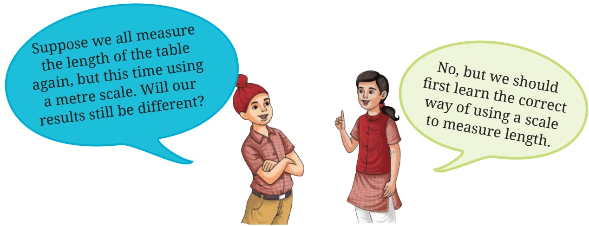
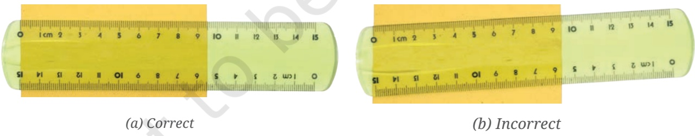

## 5.3 Correct Way of Measuring Length

For measuring any length, we need an appropriate scale. For example, if you want to measure the length of your pencil, you may use a 15-cm scale. Similarly, if the height of a room is to be measured, you may need a metre scale or a measuring tape. You cannot directly measure the girth of a tree or the size of your chest using a metre scale. For such measurements, flexible measuring tape, such as a tailor’s tape is more suitable.

While measuring lengths, we need to take care of some points.

**What is the correct way to place the scale?**

Place the scale in contact with the object along its length as shown in Fig. 5.4.

Fig. 5.4: Method of placing the scale

## What is the correct position of the eye while reading the scale?

For example, if you are trying to measure the length of a pencil by aligning it with a scale, the position of your eye should be directly above the tip of the pencil (Fig. 5.5).