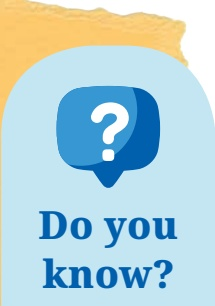
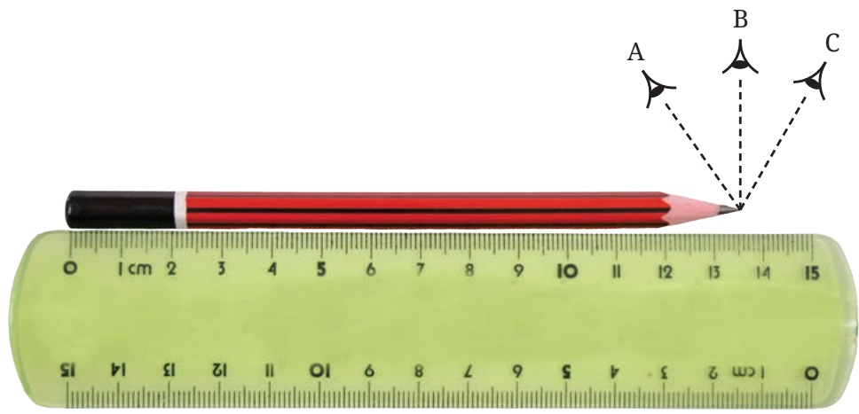
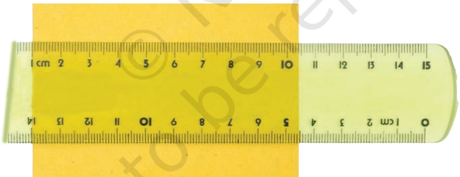

Fig. 5.5: Correct position of the eye is ${ } ^ { \circ } \mathcal { B } ^ { \flat }$

## How to measure the length if the ends of the scale are broken?

If the ends of the scale are broken or the zero marking is not clear, it can still be used for measurement. With such a scale, use any other full mark of the scale, say, 1.0 cm (Fig. 5.6). Then you must subtract the reading of this mark from the reading at the other end. For example, in Fig. 5.6, the reading at one end is 1.0 cm and at the other end, it is 10.4 cm. Therefore, the length of the object is 10.4 cm–1.0 cm = 9.4 cm.

Fig. 5.6: Correct method of placing the scale with broken end

How do visually challenged students measure lengths? They use scales with raised markings that can be felt by touching them.

**Do you know?**