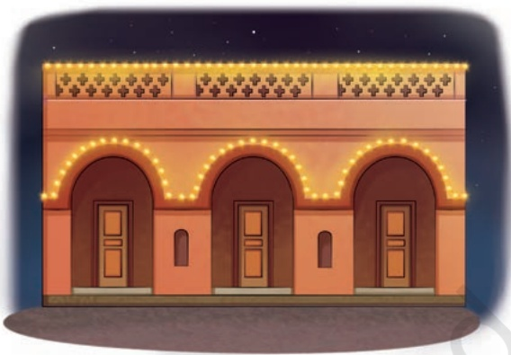
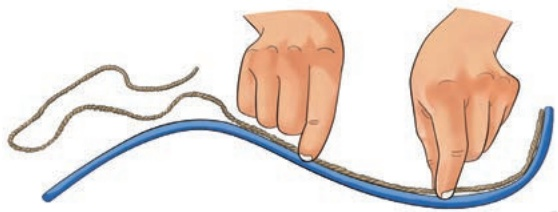
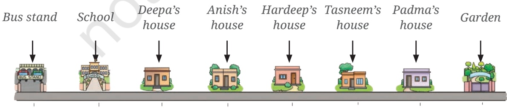

## 5.4 Measuring the length of a curved line

Anish and his parents fixed electric string lights on the

arches of the verandah of their house, as shown in Fig. 5.7, for a celebration at home. How would they have measured the required length of string lights?

In the case of a curved line, measurements can be made with the help of a flexible measuring tape or by using a thread as shown in Fig. 5.8.

Fig. 5.7: House decorated with string lights

The thread can then be straightened and its length can be measured using a metre scale.

Fig. 5.8: Measuring the length of a curved line

## 5.5 Describing Position

One day the teacher informs her students that she has planned an educational visit to a nearby garden. She asks the students to reach there directly in the morning. Deepa and her friends start discussing whether the garden would be closer than their school or farther. Tasneem and Padma say that the garden would be closer, while Deepa and Anish feel that the school would be closer, Hardeep thinks that both would be almost at an equal **distance** (Fig. 5.9).

Fig. 5.9: Location of bus stand, school, garden and houses of Deepa and her friends