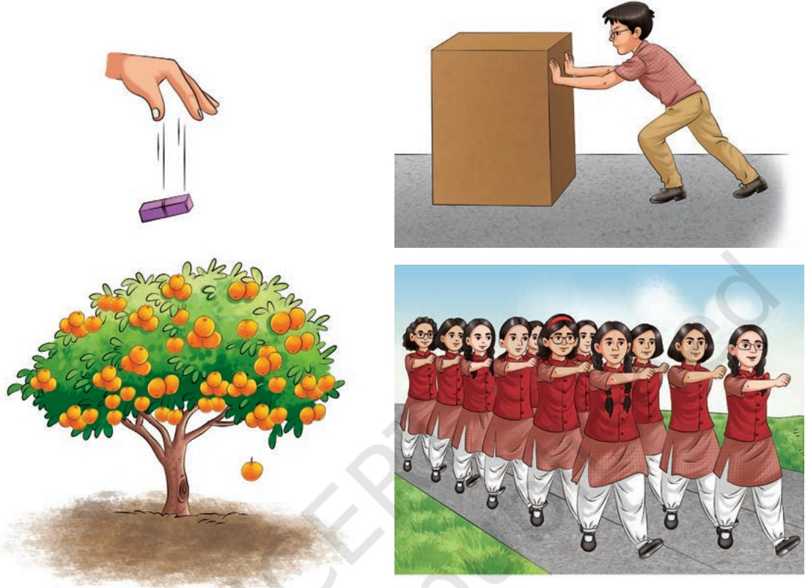

Fig. 5.14: Linear motion

When an object moves along a straight line, its motion is called **linear motion**. **Identify** such linear motion in your surroundings.

But do things always move along a straight line? You might have enjoyed playing on swings and merry-go-rounds. Are these types of motion also linear motion?

## Activity 5.4: Let us investigate

‹ Tie an eraser (or a potato) to one end of a thread.

‹ Hold the other end of the thread with your hand and whirl it (Fig. 5.15).

Observe its motion.

Is the motion of the eraser the same as that of a merry-goround?

When an object moves along a circular path, its motion is called **circular motion.**