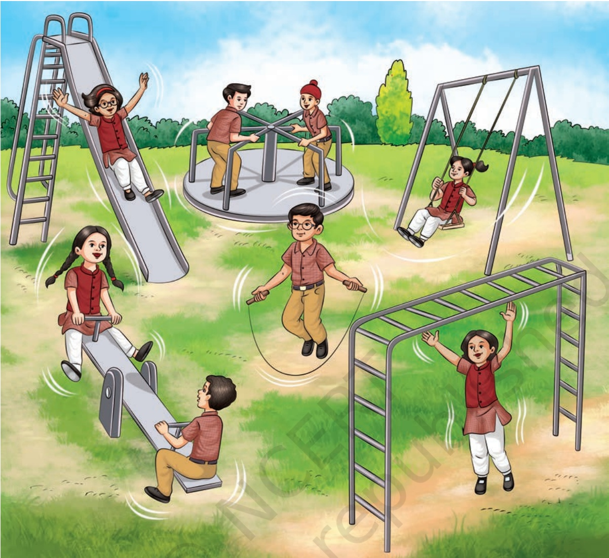

Fig. 5.18: Types of motion observed in a children’s park

Table 5.4: Types of Motion

| Object | Linear motion | Circular motion | Oscillatory motion |
| --- | --- | --- | --- |
| Swing |  |  | Moving to and fro |