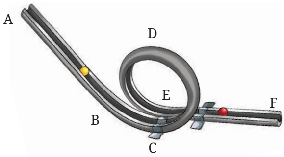

6. Take a tumbler or a bottle. Measure the length of the curved part of the base of glass or bottle and record it.

7. Measure the height of your friend and express it in (i) metres (ii) centimetres and (iii) millimetres.

8. You are given a coin. Estimate how many coins are required to be placed one after the other lengthwise, without leaving any gap between them, to cover the whole length of the chosen side of a notebook. Verify your estimate by measuring the same side of the notebook and the size of the coin using a 15-cm scale.

9. Give two examples each for linear, circular and oscillatory motion.

10. Observe different objects around you. It is easier to express the lengths of some objects in mm, some in cm and some in m. Make a list of three objects in each category and enter them in the Table 5.6.

Table 5.6: Sizes of objects around us

| Size | Objects |
| --- | --- |
| mm |  |
| cm |  |
| m |  |

11. A rollercoaster track is made in the shape shown in Fig. 5.19. A ball starts from point A and escapes through point F. Identify the types of motion of the ball on the rollercoaster and corresponding portions of the track.

Fig. 5.19: Rollercoaster track