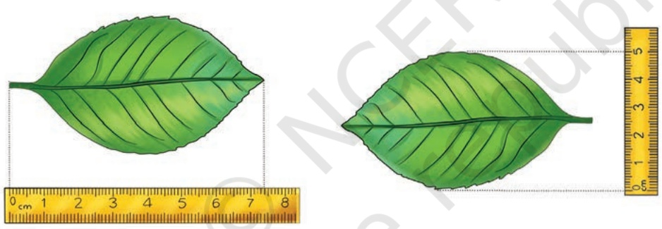

12. Tasneem wants to make a metre scale by herself. She considers the following materials for it—plywood, paper, cloth, stretchable rubber and steel. Which of these should she not use and why?

13. Think, design and develop a card game on conversion of units of length to play with your friends.

## Learning further

‹ Can you find the thickness of a single page of your notebook or textbook using a scale? Think of a way and write it. Carry out the activity and report your result.

Collect fallen leaves from the same tree. Identify the name of the tree whose leaves you have taken. Measure length and breadth of all these leaves using a 15-cm scale, as shown in Fig. 5.20. Record your observations in the Table 5.7.

Fig. 5.20: Measuring a leaf

Table 5.7: Length and breadth of leaves

| S. no. | Name of tree | Lengthof leaf | Breadthof leaf |
| --- | --- | --- | --- |
| 1. |  |  |  |
|  |  |  |  |
|  |  |  |  |

Discuss why the leaves of the same tree vary in length and breadth.