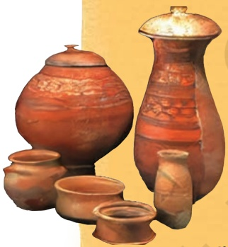

others?” All things are made up of some materials like paper, wood, cloth, glass, metal, plastic, clay, and so on. Any substance that is used to create an object is referred to as **material**.

## Activity 6.1: Let us identify

Make a list of objects you see around and also write the names of the materials they are made up of in Table 6.1.

Table 6.1: Identify materials

| I observe | Materials they aremade up of |
| --- | --- |
|  |  |
|  |  |

Based on everyday observations, one can conclude that objects are made up of various materials.

The earliest pottery found in the Indian subcontinent dates back to 7,000 to 8,000 years in the Ganga plains (Lahuradewa) and in Baluchistan (Mehrgarh). About 4000 BCE onwards, Sindhu-Sarasvatī developed techniques of wheelturned pottery production, pigmentation, application of protective or decorative coats (called ‘slips’) of B multiple colours, decorative painting, etc. Thesetechniques became further sophisticated during the Sindhu-Sarasvatī (also known as ‘Harappan’) Civilisation (2600–1900 BCE), with a bright red surface

painted with black-coloured designs displaying t i tt , d ti d t trial geome r c pa erns an aqua c an erres an ma s. e c ay use or ma ng pots, s es, i l Th l d f ki di h

bowls and other items was carefully selected and cleaned, sieved, kneaded, turned over a wheel and finally baked in kilns (baked clay is called ‘terracotta’). Pots were used for various purposes, from cooking to storage of food grains, oil, ghee, and so on. Some very large storage jars and other pottery items are exhibited at the National Museum, New Delhi.

**Do you know?**