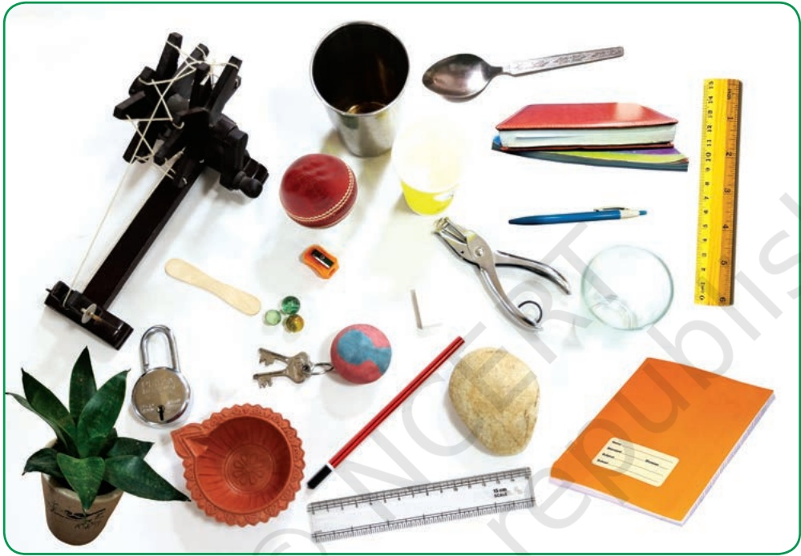

Let us explore materials further.

## 6.2 How to Group Materials?

**Activity 6.2: Let us group**

‹ Group the objects shown in Fig. 6.1 based on any common property, such as shape, colour, hardness, softness, shine, dullness or materials they are made up of.

Fig. 6.1: Objects around us

Which property did you use to group the objects in Activity 6.2?

‹ Did your friends group objects based on similar properties?

What did you learn from this activity?

You must have noticed that an object can be made from different materials and some materials can be used to make more than one object.

The method of arranging the objects into groups is called **classification**. Objects can be classified on the basis of a common property that they have.

Similarly, we can classify materials based on certain properties.