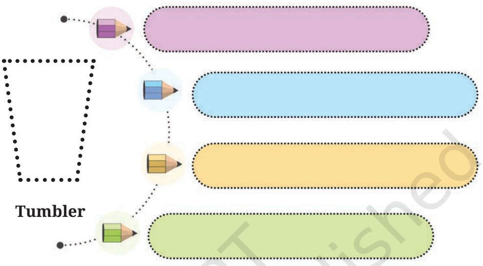
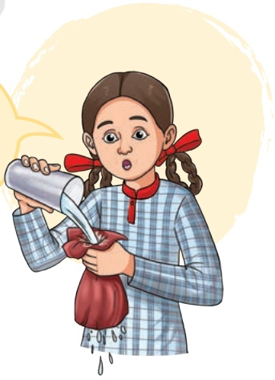

## Activity 6.3: Let us think

Let us think what materials we can use to make a tumbler. Fill in the names of the materials in the spaces provided in Fig. 6.2.

Fig. 6.2: Materials used to make a tumbler

Would it be a good idea to use paper-like materials for making cooking utensils?

Why cannot a tumbler made of cloth be used for storing water?

The materials that are required to make a tumbler should be capable of holding water.

What decides which material should be used for making an object? We choose a material to make an object depending on its properties and the purpose for which the object is to be used.

We may use different materials for making different parts of an object. For example, a pen may be made up of different materials like plastic, metal and ink.