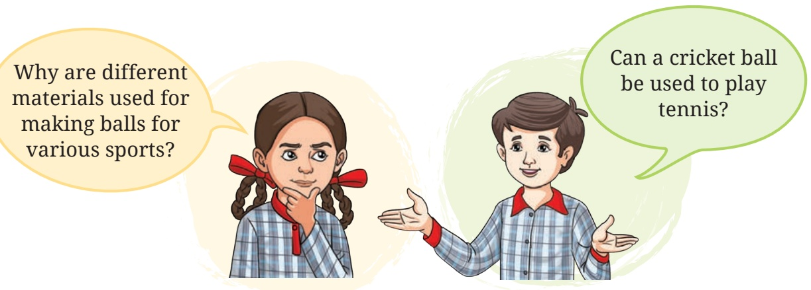
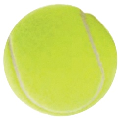
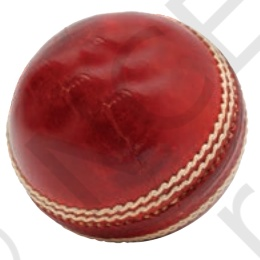
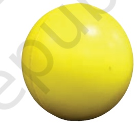

Why are different materials used for making balls for various sports?

Can a cricket ball be used to play tennis?

## Activity 6.4: Let us explore

Fig. 6.3 illustrates a variety of balls that are of the same size but made up of different materials.

‹ Take each ball and drop it from a fixed height.

‹ Note the height to which the ball bounces and **record** it in Table 6.2.

Identify the ball that achieves the highest bounce.

Tennis ball

Cricket ball

Hand exercise ball

Fig. 6.3: Different types of balls used for various purposes

Table 6.2: Bouncing level of the balls

| Ball | Bounce (high, medium or low) |
| --- | --- |
| Tennis ball |  |
| Cricket ball |  |
| Hand exercise ball |  |
| Any other |  |