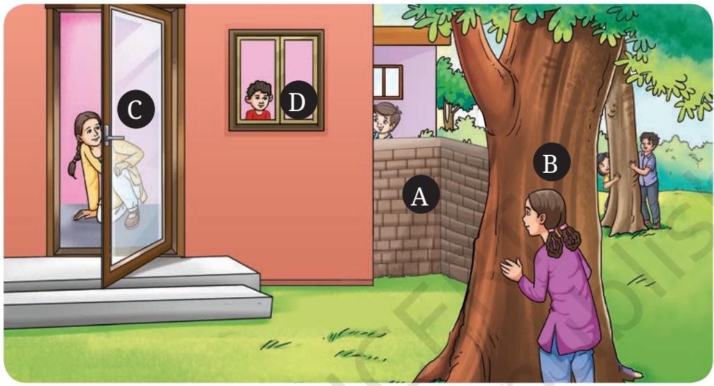
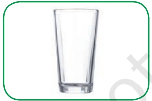
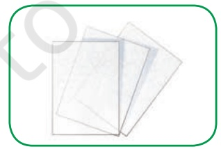
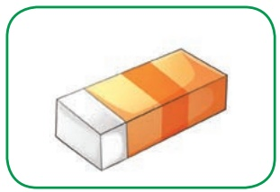
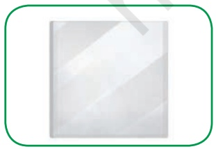
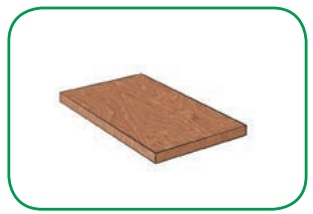
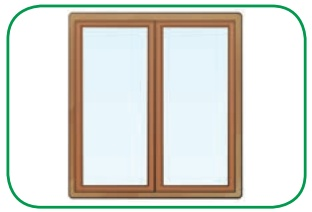

There are many materials through which you are not able to see at all. These materials are called **opaque**. Wood, cardboard and metals are examples of opaque materials.

The materials through which objects can be seen, but not clearly, are known as **translucent**. Butter paper and frosted glass are examples of translucent materials.

Look at Fig. 6.5. Identify and label the nature of materials used by Ghulan (A), Sheeta (B), Sara (C) and Sheeta’s brother (D).

Fig. 6.5: Identify the nature of different materials

(A) (B)

(C)

(D)

## Activity 6.6: Let us classify

Classify the following objects as transparent, translucent or opaque in Table 6.4.

Glass tumbler

Butter paper

Eraser

Frosted glass

Wooden board

Window glass

Materials Around Us