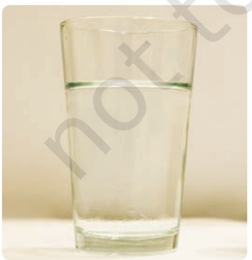
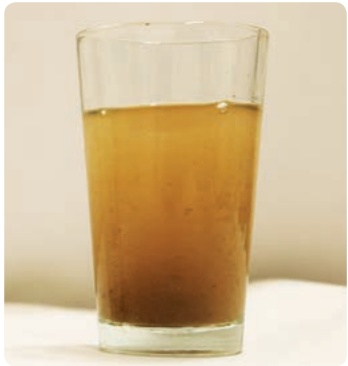

Table 6.5: Mixing different materials in water

<table><tr><td rowspan=2>Material</td><td>Prediction</td><td>Observation</td></tr><tr><td>Will disappearin water/will notdisappear in water</td><td>Disappears in water/does not disappearin water</td></tr><tr><td>Sugar</td><td></td><td></td></tr><tr><td>Salt</td><td></td><td></td></tr><tr><td>Chalk powder</td><td></td><td></td></tr><tr><td>Sand</td><td></td><td></td></tr><tr><td>Sawdust</td><td></td><td></td></tr><tr><td>Any other</td><td></td><td></td></tr></table>

You might have noticed that some materials completely disappear when mixed in water. We say that these materials dissolve in water or, in other words, they are **soluble** in water (Fig. 6.6a). Some materials do not mix with water and do not disappear even after we stir them for a long time. These materials are **insoluble** in water (Fig. 6.6b).

**everything you put in water** disappear?

Water plays an important role in the functioning of our body because it can dissolve a large number of materials.

(a) Soluble material in water

(b) Insoluble material in water

Fig. 6.6: What disappears, what does not?