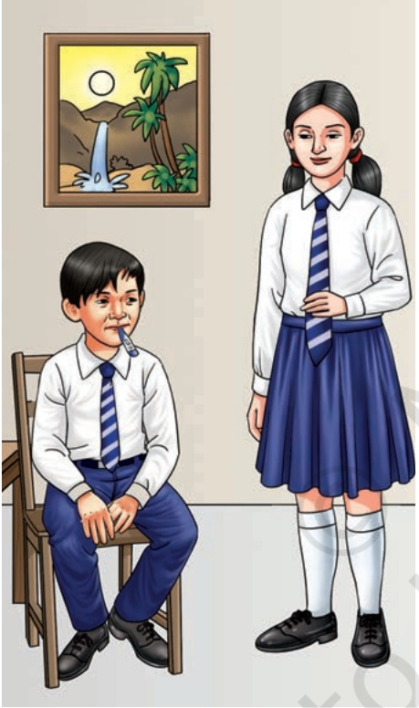

## C Wrong measurements are worse than no measurements at all.

**— Anna Mani**

Lambok and his elder sister Phiban live in Shillong. One day they came home from school. Their parents were away at work and Lambok complained that he was feeling feverish. Phiban touched his forehead and felt that he might be having a fever. To confirm this, she took out the thermometer kept in the almirah. She washed its tip with soap and water, and measured Lambok’s temperature. To her relief, she found that his temperature was normal. She washed the thermometer tip again, dried

it and put it back. She then asked Lambok to change his school uniform, eat his lunch, and rest for some time.

**Can it always be correctly judged, that a person has fever, only by touching the person?**

0677CH07

## 7.1 Hot or Cold?

We know from experience that some bodies are hotter than others. For example, during summers, the tap water may be hotter than the cold water from a matka (earthen pot) or a