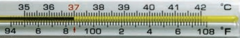

temperature when the thermometer is placed in contact with a person’s body.

For measuring temperature, the clinical thermometers generally use a scale called the **Celsius scale**. On this scale, the unit of temperature is **degree Celsius** and is denoted by °C.

Earlier, mercury thermometers were used for measuring the body temperature. But mercury is an extremely toxic substance and is difficult to dispose of if the thermometer breaks accidently.

Digital thermometers pose no such risk and also the numbers in its display are easier to read. Therefore, mercury thermometers are being replaced by digital thermometers. Temperature in a digital thermometer is determined with the help of heat sensors.

andemg the covu ermomic, someviD-19 which chleters wespecial temperaould meaere used om a diature of asure th aistance, wperson those?

**Do you know?**

They are non-contact thermometers, also called infrared thermometers. Such thermometers can measure temperature without touching a person’s body and thus reduce the risk of spreading disease.

