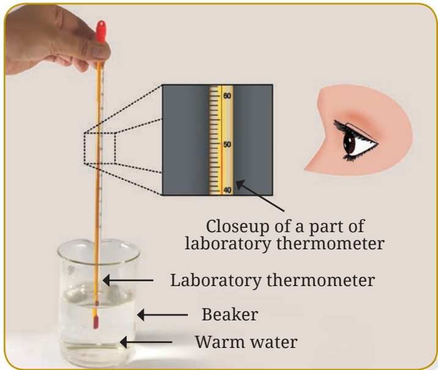
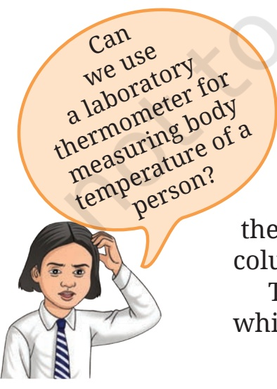

## Correct way of measuring temperature using a laboratory thermometer

Fig.7.4: Measuring temperature of warm water

When the thermometer is immersed in water, its bulb should not touch the bottom or the sides of the beaker.

The thermometer should be held vertically (Fig. 7.4). It should not be tilted.

The temperature must be read while the thermometer is immersed in water.

While reading the thermometer, the eye

should be directly in line with the level of the liquid column to be read (Fig. 7.4).

## Activity 7.5: Let us measure

‹ Take some warm water in a beaker.

‹ Dip the thermometer in water so that the bulb is immersed in water (Fig. 7.4).

Observe the rise of liquid column in the thermometer.

Wait till the column stops rising and note the temperature (do not wait too long; otherwise, the water itself will start to cool).

What is the temperature of water measured by you? Compare it with the readings of your friends.

Do you notice that, as soon as you take the thermometer out of the water, the level of liquid column begins to fall?

This means that the temperature must be read while the thermometer is immersed in water.