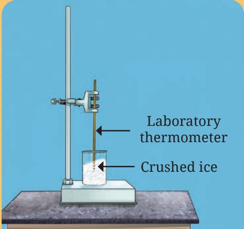
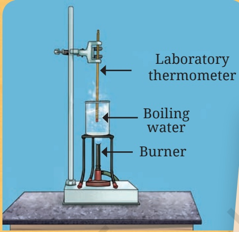

Following two experimental setups are to be arranged by your teacher. One by one, as per your turn, go closer to the setups and observe the readings of both the thermometers. What are the temperatures of ice and boiling water?

Read the temperatures of ice and boiling water again after some time. Are the temperatures same or have changed? You may have noticed that the temperature of water remains constant while it is boiling. Also, the temperature of ice remains constant while it is melting.

## Activity 7.6: Let us compare

**More to do!**

Caution This activity should be performed strictly only under supervision of the teacher. Do not touch the experimental setups.

Phiban’s Science teacher arranged the experimental setup for measuring temperature of boiling water. The temperature readings of the boiling water taken by Phiban and her classmates in Shillong are given in Table 7.2.

Table 7.2: Temperature of boiling water

<table><tbody><tr><td colspan="2">Temperature of boiling Name water (in °C)</td></tr><tr><td>Phiban</td><td>97.8</td></tr><tr><td>Shemphang</td><td>98.0</td></tr><tr><td>Onestar</td><td>97.9</td></tr><tr><td>Kloi</td><td>98.0</td></tr><tr><td>Bandarisha</td><td>98.1</td></tr></tbody></table>