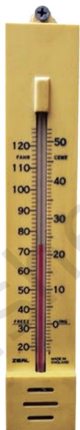

Compare the temperatures of boiling water recorded by different students.

Why are there differences in their readings? **Discuss** the possible reasons amongst yourselves. Maybe, the correct way of reading temperature was not followed by all the students.

## 7.3.3 Air temperature

You might have seen thermometers, such as the one shown in Fig. 7.5, hung on walls of your school laboratory, doctor’s clinic, and hospitals. These give an approximate idea of the room temperature.

Have you seen weather reports in newspapers, TV news or internet? These reports also mention the maximum and minimum air temperature of the day.

Fig.7.5: Room thermometer

## Activity 7.7: Let us analyse

Read or listen to the weather reports for a place for 10 successive days.

‹ Record the maximum and minimum air temperature for each day in Table 7.3.

‹ Analyse the data in Table 7.3.

Table 7.3: Maximum and minimum air temperature

<table><tbody><tr><td colspan="2">S.no. Date</td><td>Maximum air temperature</td><td>Minimum air temperature</td></tr><tr><td>1.</td><td></td><td></td><td></td></tr><tr><td>.</td><td></td><td></td><td></td></tr><tr><td>.</td><td></td><td></td><td></td></tr><tr><td>10.</td><td></td><td></td><td></td></tr></tbody></table>