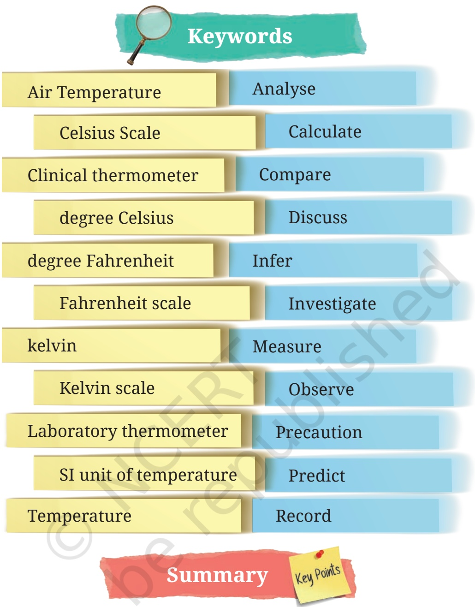

Analyse

Celsius Scale

Calculate

Clinical thermometer

Compare

degree Celsius

Discuss

degree Fahrenheit

Fahrenheit scale

Infer

kelvin

Investigate

Kelvin scale

Measure

Laboratory thermometer

Observe

Precaution

SI unit of temperature

Predict

Temperature

Record

The temperature of a body tells us how hot or cold it is.

‹ The three most-used scales of temperature are: (a) the Celsius scale, (b) the Fahrenheit scale, and (c) the Kelvin scale. The units of temperature in these scales are (a) degree Celsius, denoted by °C, (b) degree Fahrenheit, denoted by °F, and (c) kelvin, denoted by K. The SI unit for temperature is kelvin.

A clinical thermometer is used for measuring body temperature.

‹ Normal temperature of a healthy human adult is taken to be $3 7 . 0   ^ { \circ } \mathrm { C }$ or $9 8 . 6 ~ \mathrm { ^ \circ F }$

‹ Laboratory thermometers typically have a temperature range from $- 1 0 \; ^ { \circ } \mathrm { C }$ to $1 1 0   ^ { \circ } \mathrm { C } ,$