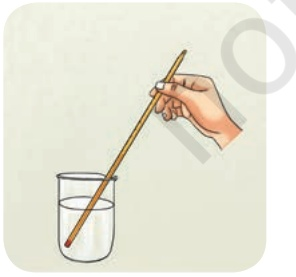
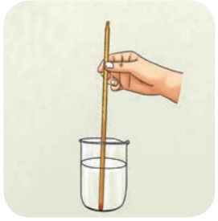
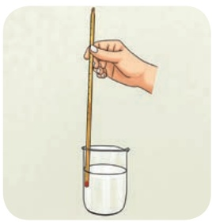

## Let us enhance our learning

1. The normal temperature of a healthy human being is close to (i) $9 8 . 6 \; ^ { \circ } \mathrm { C }$ (ii) $3 7 . 0   ^ { \circ } \mathrm { C }$ (iii) $3 2 . 0 \; ^ { \circ } \mathrm { C }$ (iv) $2 7 . 0   ^ { \circ } \mathrm { C }$

2. $3 7   ^ { \circ } \mathrm { C }$ is the same temperature as (i) $9 7 . 4 \: ^ { \circ } \mathrm { F }$ (ii) $9 7 . 6 \; ^ { \circ } \mathrm { F }$ (iii) $9 8 . 4   ^ { \circ } \mathrm { F }$ (iv) $9 8 . 6 \; ^ { \circ } \mathrm { F }$

3. Fill in the blanks: (i) The hotness or coldness of a system is determined by its (ii) The temperature of ice-cold water cannot be measured by a thermometer. (iii) The unit of temperature is degree

4. The range of a laboratory thermometer is usually (i) $1 0 \; ^ { \circ } \mathrm { C }$ to $100^{\circ}C$ (ii) $- 1 0 \; ^ { \circ } \mathrm { C }$ to $110^{\circ}\mathrm{e}$ (iii) $3 2 \; ^ { \circ } \mathrm { C }$ to $4 5 ~ ^ { \circ } \mathrm { C }$ (iv) $3 5 \; ^ { \circ } \mathrm { C }$ to $4 2 \; ^ { \circ } \mathrm { C }$

5. Four students used a laboratory thermometer to measure the temperature of water as shown in Fig. 7.6:

Student 1

Student 2

Fig. 7.6

Student 3

Student 4