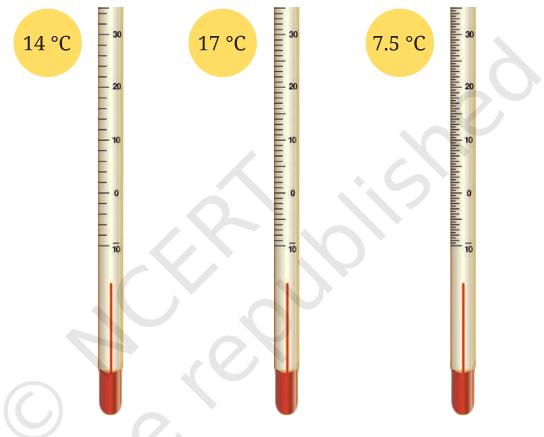
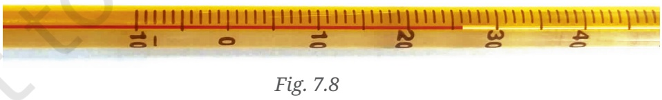

Who do you think followed the correct way for measuring temperature?

(i) Student 1

(ii) Student 2

(iii) Student 3

(iv) Student 4

6. Colour to show the red column on the drawings of thermometers (Fig. 7.7) as per the temperatures written below:

Fig. 7.7

7. Observe the part of thermometer shown in Fig. 7.8 and answer the following questions:

(i) What type of thermometer is it?

(ii) What is the reading of the thermometer?

(iii) What is the smallest value that this thermometer can measure?

8. A laboratory thermometer is not used to measure our body temperature. Give a reason.