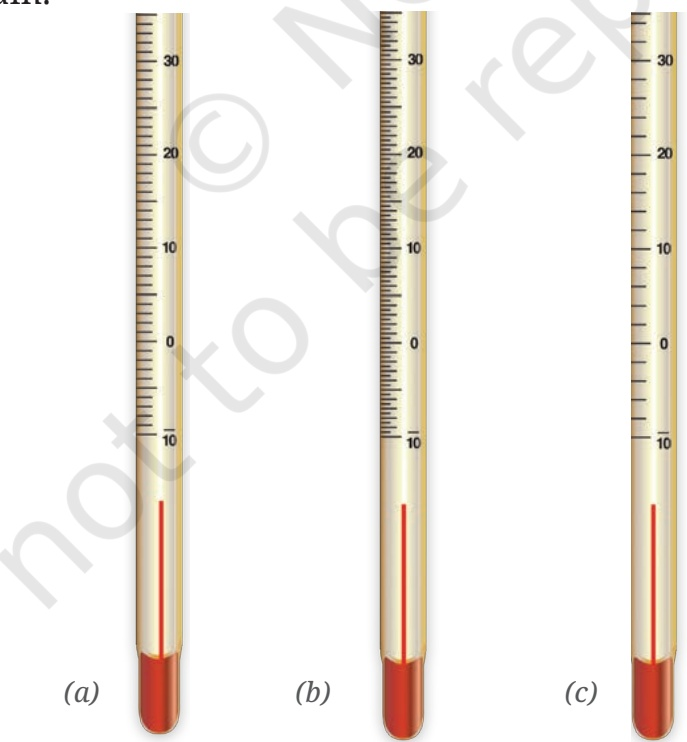

9. Vaishnavi has not gone to school as she is ill. Her mother has kept a record of her body temperature for three days as shown in Table 7.4.

Table 7.4: Body temperature record of Vaishnavi

|  |  |  | Temper | ature at |  |  |
| --- | --- | --- | --- | --- | --- | --- |
| DAY | 7am | 10am | 1pm | 4pm | 7pm | 10pm |
| One | 38.0 °C | 37.8 °C | 38.0 °C | 38.0 °C | 40.0 °C | 39.0 °C |
| Two | 38.6 °C | 38.8 °C | 39.0 °C | 39.0 °C | 39.0 °C | 38.0 °C |
| Three | 37.6 °C | 37.4 °C | 37.2 °C | 37.0 °C | 36.8 °C | 36.6 °C |

(i) What was Vaishnavi’s highest recorded temperature?

(ii) On which day and at what time was Vaishnavi’s highest temperature recorded?

(iii) On which day did Vaishnavi’s temperature return to normal?

10. If you have to measure the temperature $2 2 . 5 ~ ^ { \circ } \mathrm { C } ,$ which of the following three thermometers will you use (Fig. 7.9)? Explain.

Fig. 7.9: Three thermometers