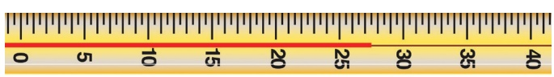

11. The temperature shown by the thermometer in Fig. 7.10 is

(i) $2 8 . 0 \; ^ { \circ } \mathrm { C }$

(ii) $2 7 . 5 \; ^ { \circ } \mathrm { C }$

(iii) $2 6 . 5 \; ^ { \circ } \mathrm { C }$

Fig. 7.10

(iv) $2 5 . 3 \; ^ { \circ } \mathrm { C }$

12. A laboratory thermometer has 50 divisions between $_ \mathrm { ~ 0 ~ } ^ { \circ } \mathrm { { C } }$ and ${ \tt 1 0 0 } ~ ^ { \circ } \mathbb { C } ,$ What does each division of this thermometer measure?

13. Draw the scale of a thermometer in which the smallest division reads 0.5 °C. You may draw only the portion between $1 0 \; ^ { \circ } \mathrm { C }$ and $2 0 \; ^ { \circ } \mathrm { C } ,$

14. Komal tells you that she has a fever of 101 degrees. Does she mean it on the Celsius scale or Fahrenheit scale?

## Learning further

Gather information from the Internet and find out how the body temperature of animals, such as a cat, dog, horse, camel, cow and buffalo, is measured. If there is any veterinary hospital in your vicinity, you may visit to see the body temperature of animals being measured.

‹ Find out which places in India are usually regarded to be the coldest and hottest. Also, find out the minimum and the maximum temperatures recorded for these places.

Various planets in our Solar System are at different distances from the Sun. Search the Internet and make a table with the planets, their distances from the Sun (in increasing order) and their temperatures written. Does the average temperature of planets decrease as their distance from the Sun increases? If it is not true for any planet, find out for which planet and why.

Hang a room thermometer in your classroom. Set up the apparatus, as shown in Fig. 7.11, near the thermometer hung on the wall.

Take the readings of thermometers 1 and 2 three times during the day, say, first period, lunch break, and last period.