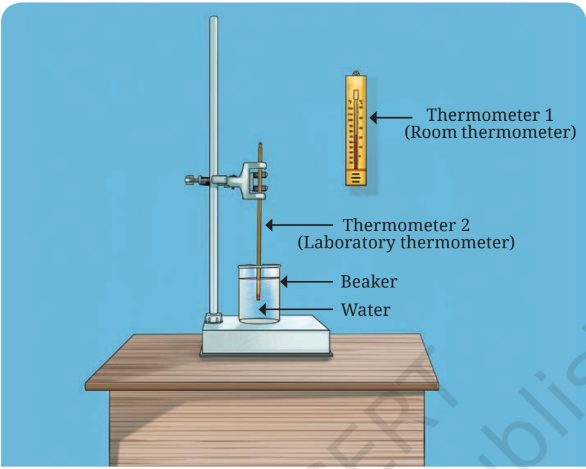

Record your readings. Compare the readings and draw your conclusions. Repeat this for two weeks.

Fig. 7.11: Set up to measure temperature of water and room temperature

More to know!

The temperature at the core of the Sun reaches as high as 15 million degrees Celsius. Are there objects in the sky that have even higher temperatures? There is no limit on the highest temperature that can exist. However, as per scientific understanding, there is a limit to the lowest temperature that can be achieved. It is close to $-273.15\;^{\circ} C$ (0 kelvin) and is called absolute zero.