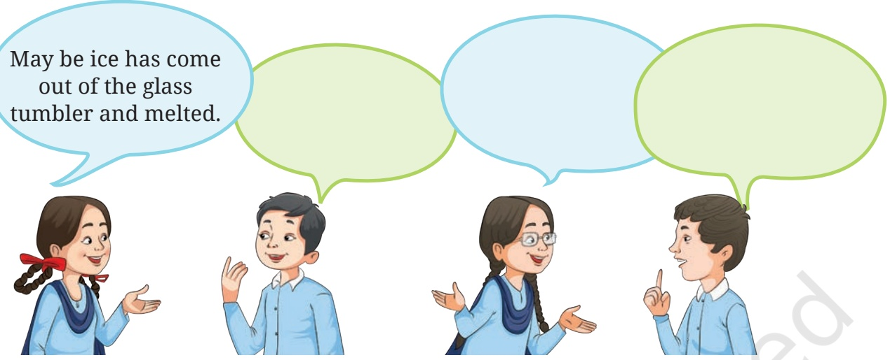
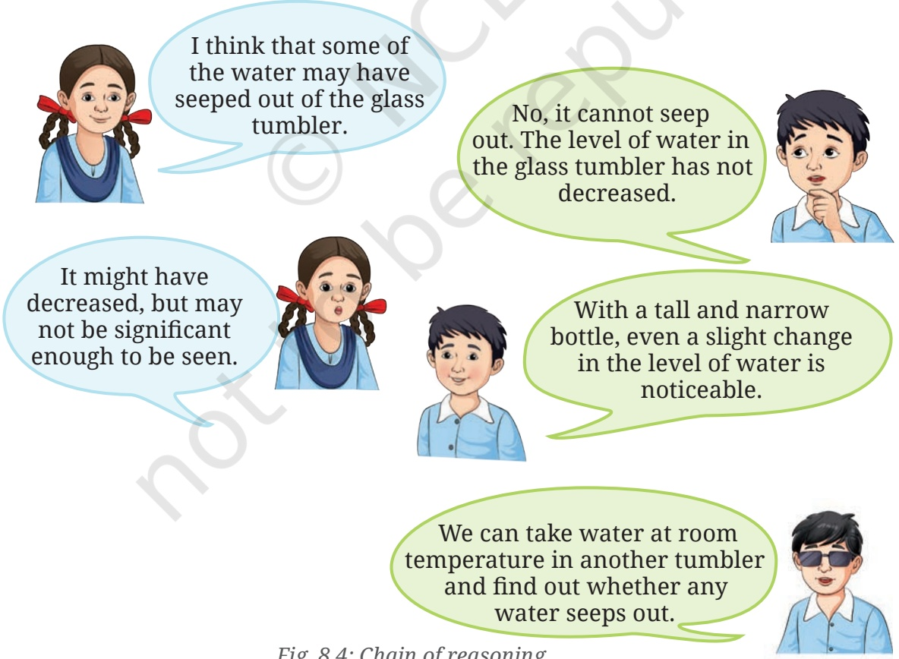

Discuss with your friends. Write down the possible reasons in Fig. 8.3.

Fig. 8.3: Provide your possible reasons explaining the appearance of water droplets on the outer surface of the glass tumbler

You may have various possible reasons. You may agree or disagree with the reasons of others. Aavi and Thirav argued with a chain of reasons. What do you think about the possible reasons mentioned in Fig. 8.4?

We can take water at room temperature in another tumbler and find out whether any water seeps out.

Fig. 8.4: Chain of reasoning