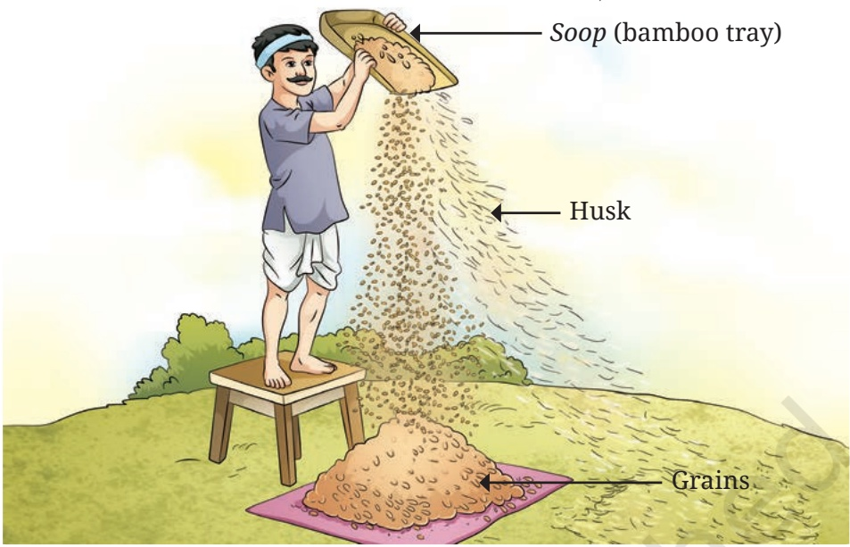
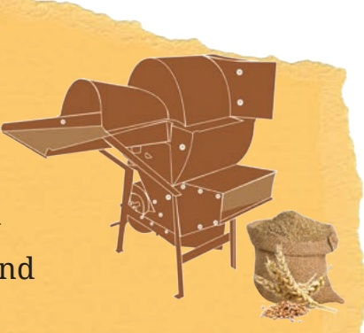

Direction of air or wind

Fig. 9.4: Winnowing

**Valli is unable to separate husk from rice in a closed room. How can you help her?**

?

This method of separating heavier and lighter components of a mixture by wind or by blowing air is called **winnowing.** Have you seen any similar kind of activity being done at your home?

More to know!

Technological developments have resulted in developing of threshing machines called threshers. These machines are used for separating grains from the stalks and husk. They perform both the tasks of threshing and winnowing simultaneously.

Next day, Malli and Valli board a train to Ahmedabad to visit their father’s friend Ghanshyam bhai. Before leaving, Valli requests her Mami to prepare meethi puri (sweet Indian bread made from wheat flour) for their journey.

Valli: Shall I help you knead the wheat flour?

Mami: To prepare a dish with flour, first we need to remove bran that may be present in the flour.

Valli: How do we do it?