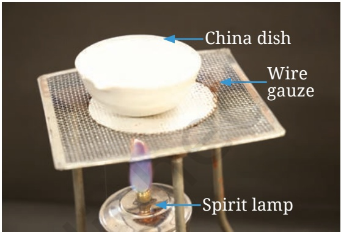
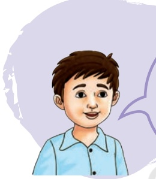
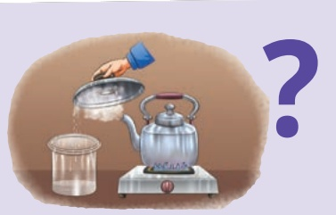

In the traditional Indian system of holistic health and medicine called Ayurveda, the herbs or parts of plants are prescribed as remedies. These ingredients like roots, leaves, flowers or seeds of various medicinal plants are often dried in the shade. This practice facilitates the evaporation of excess water, leaving behind the important part of the medicine.

Do you know?

## Activity 9.3: Let us investigate

This activity may be demonstrated by the teacher.

‹ Take some salt solution (prepared in Activity 9.2) in a china dish. If a china dish is not available, another suitable vessel may be used.

Heat and let the water boil away as shown in Fig. 9.8.

Fig. 9.8: Heating of china dish containing salt solution

**Caution**

Allow the china dish to cool down.

Be careful while heating the china dish.

‹ What do you observe? What is left in the china dish?

Did you get the salt back? You can feel the presence of salt in the china dish by touching the salt with your fingers.

Is there any method through which I can get back both salt and water?

Observe the

**figure. Does it answer the** question? Can you name the process involved?

It is now time for Malli and Valli to visit Dada and Dadi (paternal grandparents) residing in Puducherry, located in southern India. They are excited to meet their old neighbourhood friend, Balan. After reaching Puducherry, they start talking about the old times and do not realise that it is already evening, Dadi’s tea time.