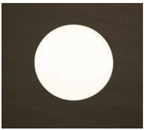
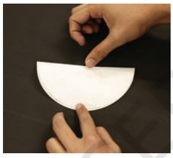
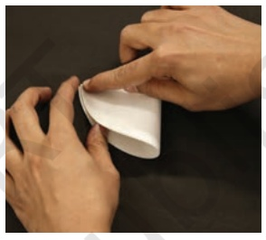
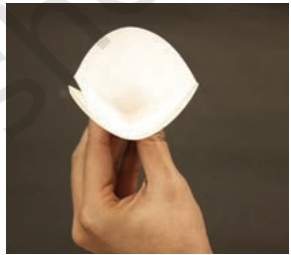
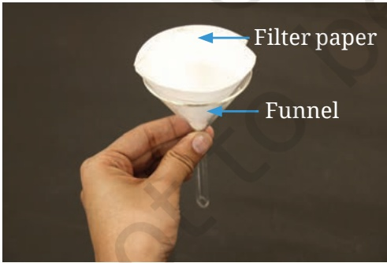
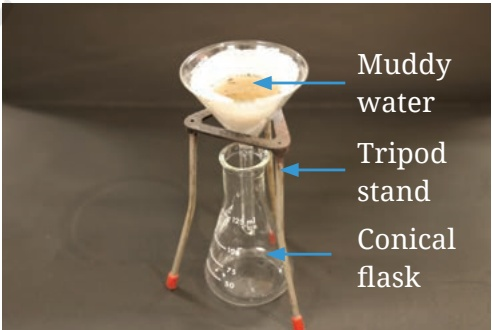

Malli: Why should we use a piece of cloth?

Dada: In a piece of cloth, there are very small holes or pores between the woven threads. These pores in the cloth can be used as a filter. People in ancient times also followed this practice.

How many layers of cloth do I need to use to get clear water?

But if the water is still muddy, impurities can be separated using a filter with even smaller holes or pores. A filter paper is one such filter that has very fine pores in it.

## Activity 9.4: Let us experiment

Try to fold the filter paper yourself and make a cone as shown in Fig. 9.10.

A filter paper

One-fold

Two-folds

Cone

Fig. 9.10: Folding a filter paper to form a cone

‹ Place it inside a funnel kept on a conical flask and pour muddy water into it (Fig. 9.11).

Fig. 9.11: Filtration

‹ What do you observe? Do the mud particles pass through the filter paper?

‹ The water coming from the funnel will be collected in the conical flask.