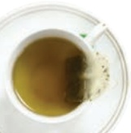
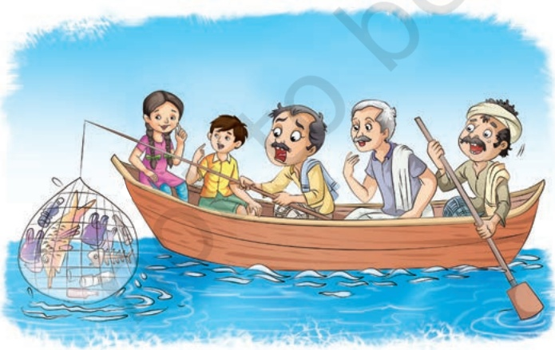

‹ You will get mud as a residue on the filter paper and clear water as filtrate in the conical flask.

**More to know!**

Other than the filter paper, many materials such as cotton, charcoal, and sand can be used as filters. The choice of filter depends upon the size of the particles of the materials to be removed.

## Activity 9.5: Let us design and create

Valli goes for a nature walk with her Dadi and collects some water from a pond in a container. She observes some unwanted substances in it. **Design** and **create** a working model of water filter using low-cost materials.

Tea bags were initially made of soft cloth, like silk, because it could hold the tea leaves and let water pass through. Silk was strong and did not fall apart when it touched hot water. Later, people started using gauze or muslin. Eventually they began using filter paper, which is what most tea bags are made of today.

**Do you know?**

Malli and Valli go on a boat ride in a nearby river with their Dada and his friend, Otukkam. Otukkam is a fisherman. As they cast the fishing net, water drains out through the mesh. Valli recalls the filtration method she had learnt and realises that this method of catching the fish is somewhat similar.

Malli is taken aback when he sees plastic bags, broken bottles, a large fish with a straw stuck in its mouth, and food wrappers along with the other fish trapped in the net.