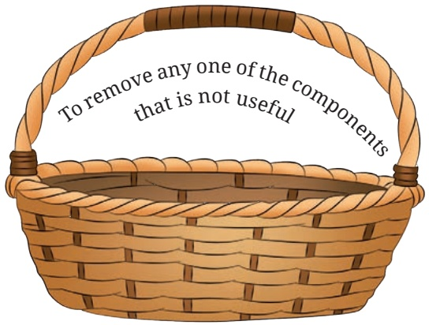
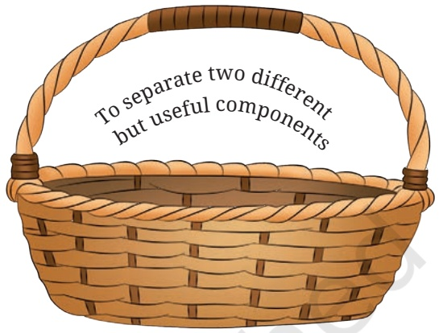

Now, take two baskets, each representing one of the two purposes for which we separate substances. Form two teams and see who will get the maximum correct entries.

## Think and start

This activity helps in assessing your understanding as to why we separate substances.

## Keywords

Churning

Mixture

Create

Decantation

Sedimentation

Design

Evaporation

Experiment

Filtration

Sieving

Handpicking

Threshing

Explore

Winnowing

Infer

Magnetic separation

Investigate

Observe