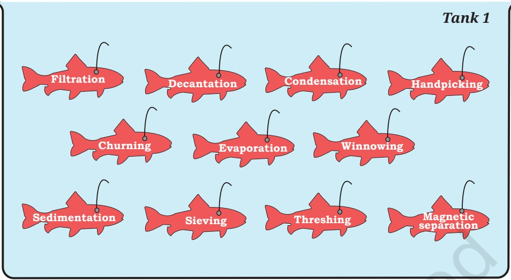
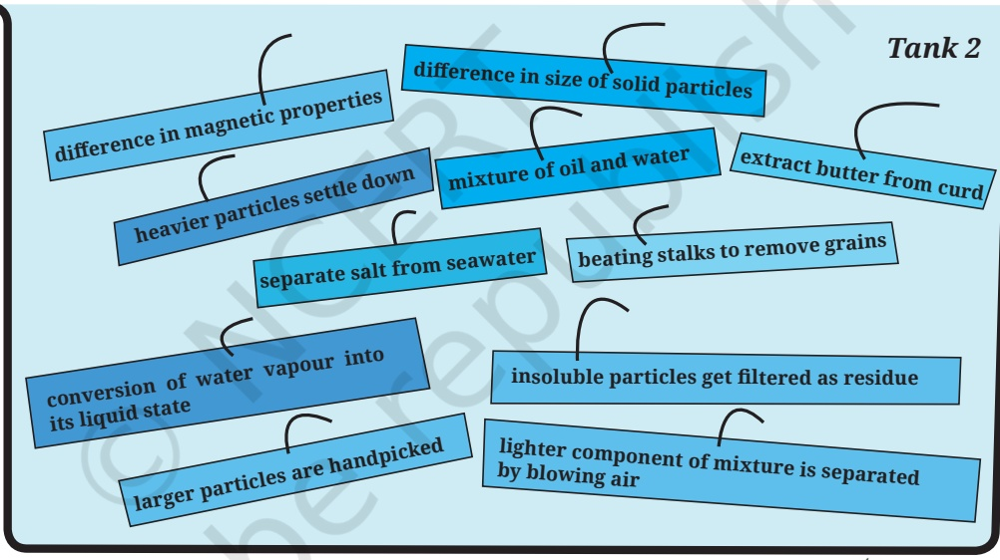

Catch me first!

Then me!

## Let us enhance our learning

## What purpose does handpicking serve in the process of separation?

(i) Filtration (ii) Sorting (iii) Evaporation (iv) Decantation

## 2. Which of the following substances are commonly separated using the churning method?

(iii) Cream from milk