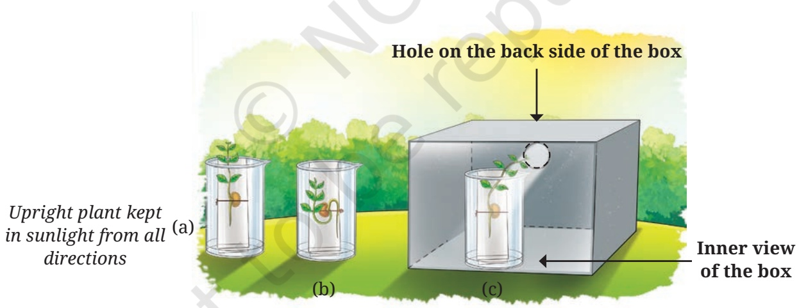

Table 10.3: Growth of root and shoot under different conditions

<table><tr><td rowspan=3>Beakers</td><td></td><td></td><td></td><td></td><td></td></tr><tr><td rowspan=2>Directionofsunlight</td><td rowspan=2>Directionof plant</td><td colspan=3>Direction of growth ofroot and shoot</td></tr><tr><td>Shoot/Root</td><td>Predictions</td><td>Observations</td></tr><tr><td rowspan=2>A</td><td rowspan=2>Alldirections</td><td rowspan=2>Upright</td><td>Shoot</td><td></td><td></td></tr><tr><td>Root</td><td></td><td></td></tr><tr><td rowspan=2>B</td><td rowspan=2>Alldirections</td><td rowspan=2>Inverted</td><td>Shoot</td><td></td><td></td></tr><tr><td>Root</td><td></td><td></td></tr><tr><td rowspan=2>C</td><td rowspan=2>Onlyfrom onedirection</td><td rowspan=2>Upright</td><td>Shoot</td><td></td><td></td></tr><tr><td>Root</td><td></td><td></td></tr></table>

What is the direction of growth of root and shoot in beakers A, B and C based on your observations? Do your predictions match your observations? What do you **conclude** from this activity?

Upright plant kept in sunlight from all directions

Inverted plant kept in sunlight from all directions

Inner view of the box

Upright plant kept in sunlight from one direction

Fig. 10.3: Direction of growth of root and shoot under different conditions

From the results of this **experiment** (Table 10.3 and Fig. 10.3), we note that—

1. When the plant is kept upright, the root grows downwards and the shoot grows upwards.