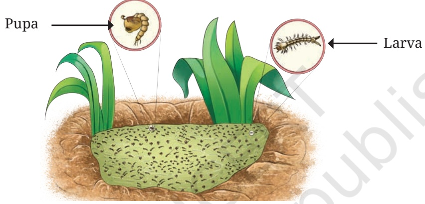

Conduct a safety audit in your school, or at your home and surroundings to check for stagnant water (if available, carry a hand lens to observe any small creatures). Some common places where stagnant water is likely to gather are desert coolers, planted pots and any open container. You may find two different types of worm-like creatures (Fig. 10.5). They are **larva** and **pupa**, two distinct life stages during the development of mosquito. In case you observe larvae and pupae, report to your teacher. Discuss with the teacher and classmates about the necessary measures one can take to prevent breeding of mosquitoes. What differences do you observe in the shape of larvae and pupae?

Fig. 10.5: Larvae and pupae of mosquitoes in a stagnant water body

Mosquito larvae and pupae observed in water bodies repeatedly come to the water surface. What can be the reason for this? Mosquito larvae and pupae live in water and require air to respire. They move to the surface of the water for air.

**How can the life cycle of a mosquito be disrupted?**

I have seen my mother spraying kerosene oil on stagnant water. Why does she do so?

Kerosene oil forms a thin layer over the water surface. This layer separates water from air, and does not allow larvae and pupae to inhale air. As a result, they die.

Characteristics Living Creatures: Exploring their