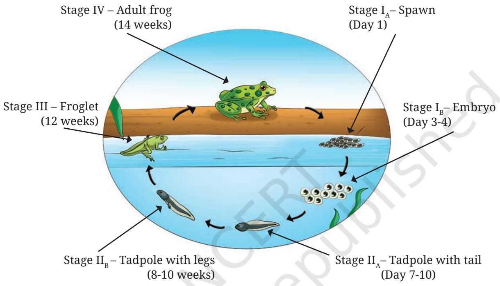

Some of the stages have been clubbed together, for example, stages A and F in Fig. 10.7 have been kept under stage I. You will find four stages in the life cycle of a frog— the egg stage, which progresses to the embryo stage; the **tadpole** stage, consisting of an early stage with a tail and no legs, and a late stage with hind legs; the **froglet** stage, and the adult frog stage (Fig. 10.8).

Fig. 10.8: Life cycle of a frog

Discuss in the class along the following points:

How are these eggs of a frog different from the other eggs that you may have seen?

‹ Which stage has the shortest duration?

‹ Is there a change in the habitat during the various stages in the life cycle of a frog?

How do the special features support that stage?

Observe Fig. 10.8. You will see that tadpoles develop legs but still have tails. Tails help them swim in water. Tadpoles grow gradually and start looking like little frogs called froglets. They still live in water but begin to spend some time on land. They continue to grow and lose their tails completely. Their legs become strong to help them jump and land. They become fully developed adult frogs who live both in water and on land.