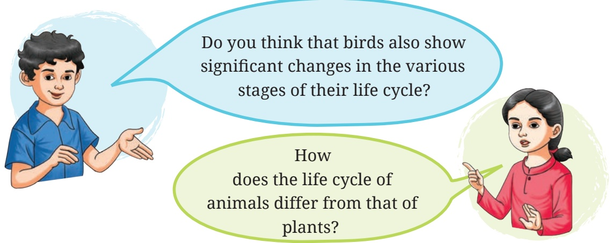
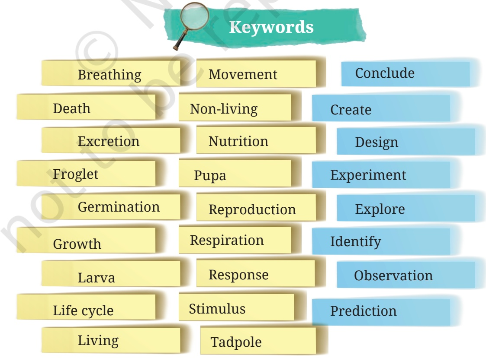

Plants and animals are a part of the living world. They go through various changes during the course of their lives. We have learnt that a tiny plant grows and develops into a big tree. We have also learnt how animals grow and change from young ones to adults. This journey varies for each animal, making it unique and special. We have seen pupae change into insects, and tadpoles change into frogs. Such changes are important for plants and animals to survive and to maintain continuity of their kind. We should also take care of them and their homes. By nurturing and preserving their homes, we contribute to this flourishing living world.

