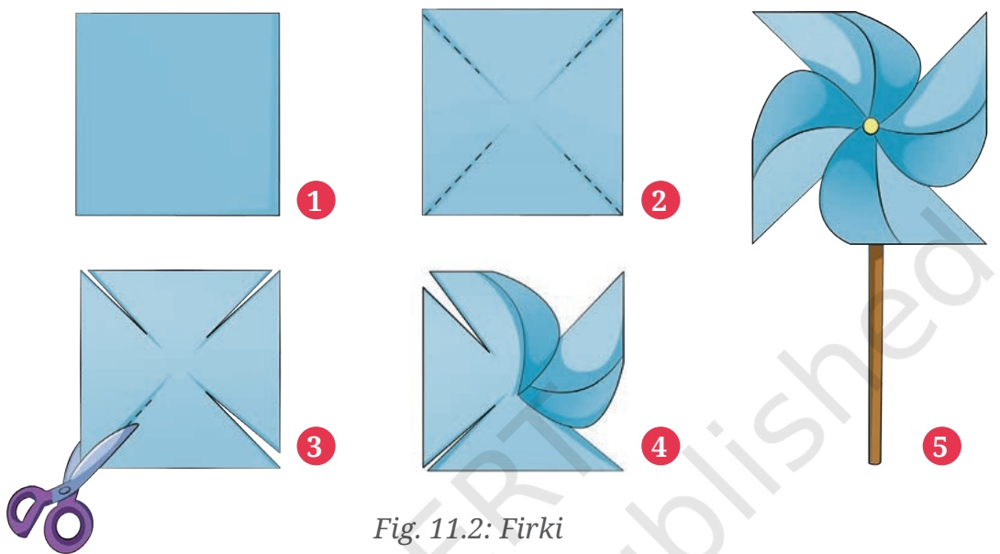

## Activity 11.2: Let us make and decorate

Take a square paper of size 15 cm x 15 cm, a pair of scissors, an all-pin and a soft stick.

‹ Follow the instructions shown in Fig. 11.2 to make a firki.

Now, you can hold the firki in your hand and run. You can also blow air on it. What do you observe? Does the firki rotate? When you move it a little back and forth, the firki rotates. What makes a firki rotate? It is the wind that makes a firki rotate.

Fig 11.3: A windmill farm

The working of a windmill is similar to that of a firki. Wind rotates the wings of a windmill. Windmills can be used to run flour mills, to pull up water from a well, or to generate electricity. In India, there are many windmill farms. A windmill farm is an area that has a large number of windmills which use the energy of the wind to generate electricity (Fig. 11.3).

Muppandal Wind Farm in Tamil Nadu, Jaisalmer Wind Park in Rajasthan and Brahmanvel Wind Farm in Maharashtra are some of the leading windmill farms in our country. Find out more other windmill farms in our country.

More to **know!**