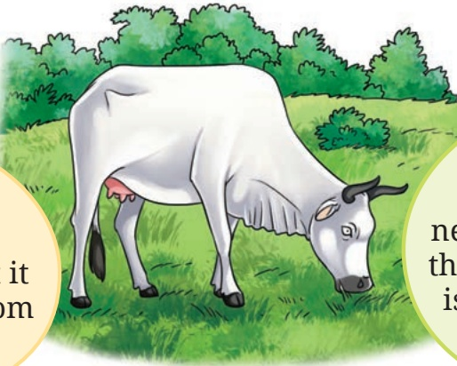
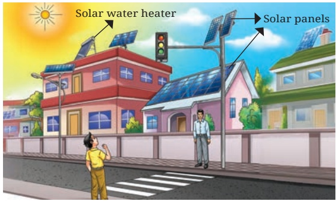

Look at this cow. It is grazing the grass and getting energy from it.

No, I think this cow is getting energy from the Sun.

The cow is standing in the Sun. But it does not mean that it is getting energy from the Sun.

The cow is eating grass. Grass leaves need sunlight to grow. So, the main source of energy is the Sun. This way the cow gets energy from the Sun.

**According to you, whose statement is correct and why?**

Sunlight helps plants prepare food. The Sun also provides all the living beings on Earth with heat and light. It is their main source of energy.

In many households in India, water is offered to the Sun early in the morning as an expression of gratitude to the Sun.

**Do you know?**

Have you seen solar panels on rooftops, on top of street lights or on traffic signals? The solar panels capture the Sun’s energy and produce electricity. Energy from the Sun can also be directly used for cooking in a solar cooker or for heating water in a solar water heater.

Uses of solar energy