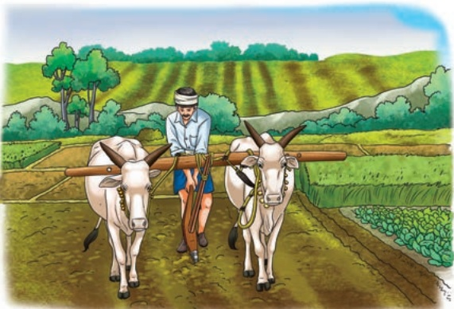

‹ Observe the soil samples with your naked eye. If you have a magnifying lens, look at the soil through it.

‹ Record your observations in Table 11.2.

Table 11.2: Soil samples

<table><tbody><tr><td colspan="2">Location from What I which soil guessed sample was about the collected soil?</td><td>Observation of soil with naked eye including its colour and texture</td><td>Observation of soil with magnifying lens</td></tr><tr><td>Soil from a farm after ploughing</td><td></td><td></td><td></td></tr><tr><td></td><td></td><td></td><td></td></tr><tr><td></td><td></td><td></td><td></td></tr></tbody></table>

‹ Is there any difference between your guess and what you can actually observe when you look closely?

‹ Do you see any differences in the soil samples taken from different places?

‹ Do you see differences in what you are able to observe with your naked eye and what you can observe with a magnifying lens?

There are many things in the soil, such as sand, insects and worms. There may be many small organisms that we cannot see with our naked eyes. Plants and animals also become part of the soil as they decompose and decay. The

soil samples collected from different

places may be of different colours because they may contain different materials.

Have you ever wondered how soil is formed? Soil is formed by the disintegration (breaking apart) of rocks by actions of the Sun, water and living organisms over a long time (thousands of years). There are different types of soils. Some are good for growing certain types of

Nature’s Treasures