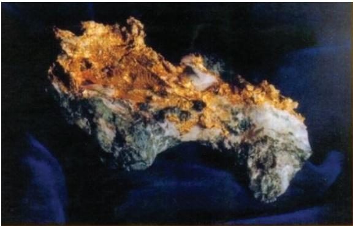
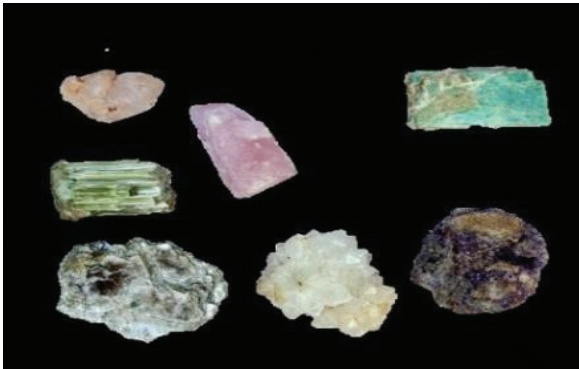
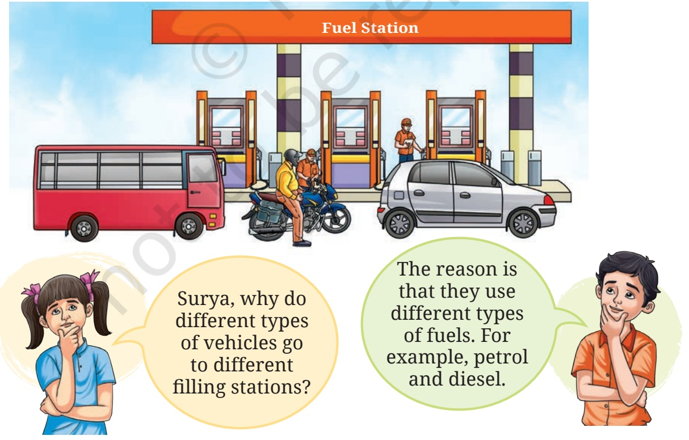

electrical and electronic equipment. For example, the basic mobile phones that we use contain about a dozen minerals like gold, silver, copper, cobalt, etc.

Naturally occurring gold

Some minerals found in nature

Rocks play a vital role in our lives. It takes thousands to millions of years to form rocks. Therefore, it is important to conserve and use them responsibly. Do you know how rocks and minerals are transported from one location to another? Most vehicles that we use for transportation use fossil fuels. Let us explore more about fossil fuels.

## 11.6 Fossil Fuels

Surya, why do different types of vehicles go to different filling stations?

The reason is that they use different types of fuels. For example, petrol and diesel.

