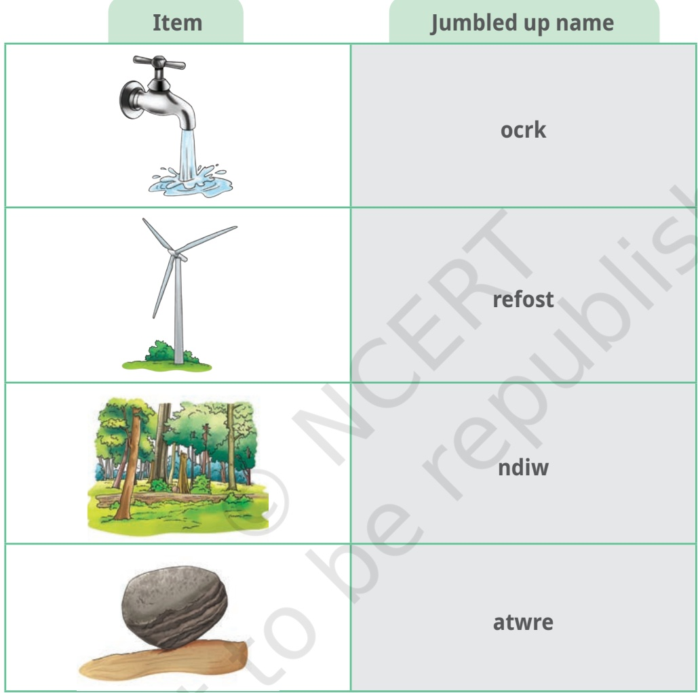

1. Fig. 11.9 shows items related to natural resources. Match them with their jumbled up names. Make another table and write the names of these resources. Classify these resources as renewable or non-renewable.

## Item

Fig. 11.9: Natural resources

2. State whether the following statements are True [T] or False [F]. If False, correct them.

(i) Nature has all the resources to meet human needs. [ ]

(ii) Machines are a resource found in nature. [ ]

(iii) Natural gas is a non-renewable resource. [ ]

(iv) Air is a renewable resource. [ ]