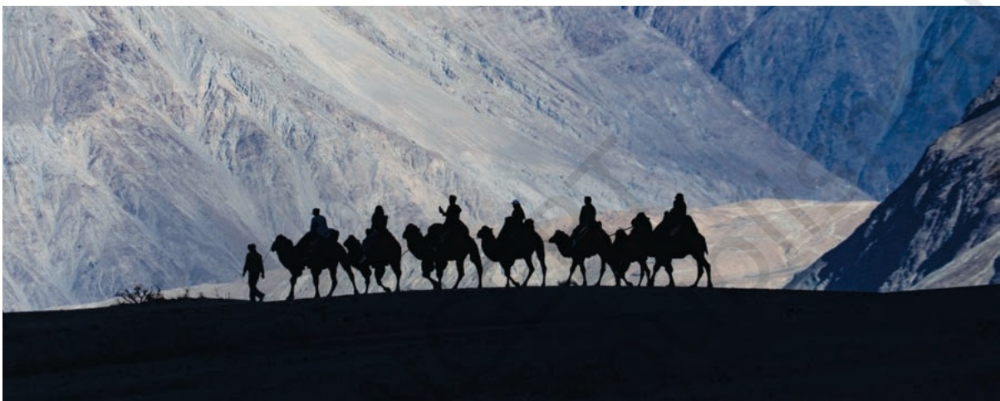
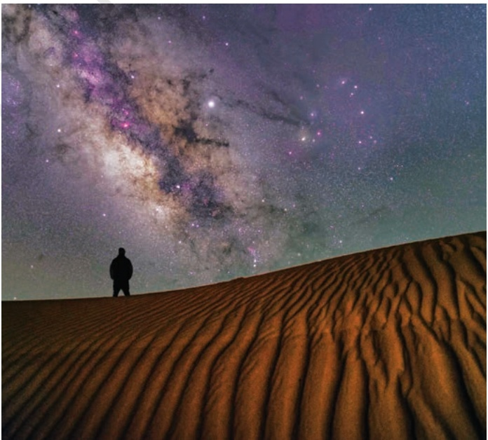

Nubra is a beautiful region in Ladakh. An eleven-year old girl Yangdol and her twin brother Dorjay live in one of the villages of this region.

0677CH12

Nubra in Ladakh, India

They love their surroundings—the majestic mountain peaks, and the glaciers, but their favourite is the night sky when the entire sky is lit up with thousands of stars (Fig. 12.1). The weather in Nubra is almost cloudless. With almost no air or light pollution, the night sky is very clearly visible. Night after night, Yangdol and Dorjay observe the stars and experience an immense sense of awe.

Fig. 12.1: The beauty of night sky from a very dark location in Ladakh, India