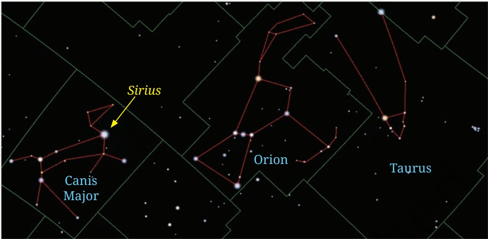
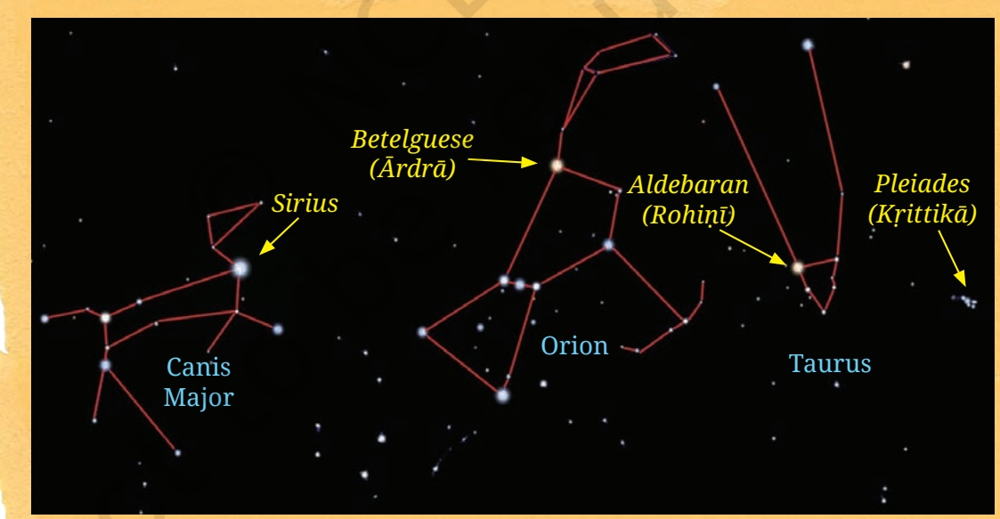

called Sirius, which is the brightest star in the night sky (Fig. 12.3).

Fig. 12.3: Some constellations and stars

(The red lines indicate the patterns of stars while the green lines indicate the regions of the sky. The lines are not seen in the sky and have been drawn only for easy identification)

**More to know!**

In Indian astronomy, the term nakṣhatra is used to denote either a certain star or a group of stars, such as Ārdrā (a star called Betelgeuse in the Orion constellation) and Kṛittikā (a group of stars called Pleiades in the Taurus constellation). Aldebaran, a star in the constellation Taurus, is known as Rohiṇī.