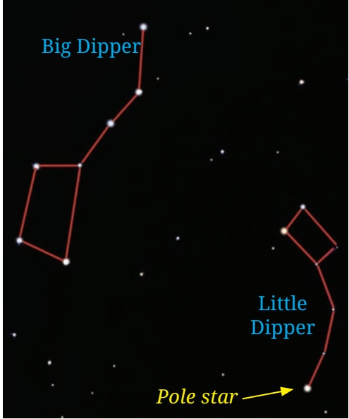

Two distinct patterns of stars, the Big Dipper and the Little Dipper, are shown in Fig. 12.4. The **Pole Star** or Polaris, which is part of the Little Dipper is also shown (Fig. 12.4).

The Pole Star appears nearly stationary in the North direction. This helps to locate the North direction in the Northern hemisphere.

Big Dipper

The Big Dipper lies in the constellation Ursa Major while the Little Dipper lies in the constellation Ursa Minor. In India, the Big Dipper is known as Saptaṛiṣhi, and the Pole Star is known as Dhruva tārā.

**More to know!**

Fig. 12.4: Big Dipper, Little Dipper and Pole Star (The lines are not seen in the sky and have been drawn only for easy identification)

Apart from common regional stories assoclated Apth stars in the constellations, many lorest lualling communities or tribes of India also nave their own stories about them. For example, al four stars in the Big Dipper that approxinateryl form a rectangle, are viewed by tribes in Centrar India as the “grandmother's cot" with the three thieves (other three stars) stealing it. Fishermen along the Konkan coast imagine the lour stars as a boat, with the last three Do you stars as the neck of the boat. know?

How can we identify some of these constellations in the night sky?

