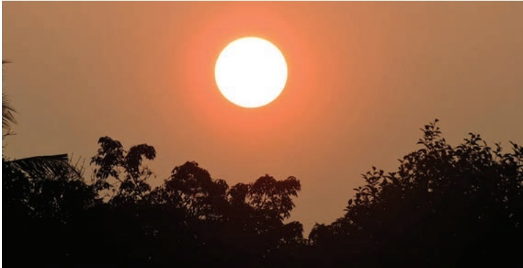

The Sun produces heat and light, and is the main source of energy on the Earth (Fig. 12.6).

How big is the Sun? It is about 100 times bigger than the Earth in diameter. And still, it looks so small because it is very far from the Earth.

Fig. 12.6: The rising Sun

The distance of the Sun from the Earth is about 150 million km A useful unit for expressing distances within the solar system is astronomical unit' (au) which is approximately the distance between the Sun and the Earth.

**More to know!**

The Sun, being the brightest obiect and the source of light most and heat on Earth, was elevated in dei anaiont civilizations to the status ol a uerty In India the Sun is worshipped as Surya. me iest provided by the Sun keeps the Lli. ntat tomperature that makes life possisie. ctnlight is essential for plants to rol, uzhich provide food and oxygen to aul, fo, naluding humans. The Sun is responsible 1or elimate seasons, weather, water tycle, wwinds—all of which are important 1o1 sustaining life on the Earth.

## Our

Sun is also a star. So how is it that the Sun appears big and lights up the sky while the other stars look like bright dots in the night sky and are not even visible during the day time?

However, the Sun is much closer to us than the other stars hence it appears much bigger than the stars. As the stars (other than the Sun) are much farther away, they appear like points, even though some of those stars are much bigger