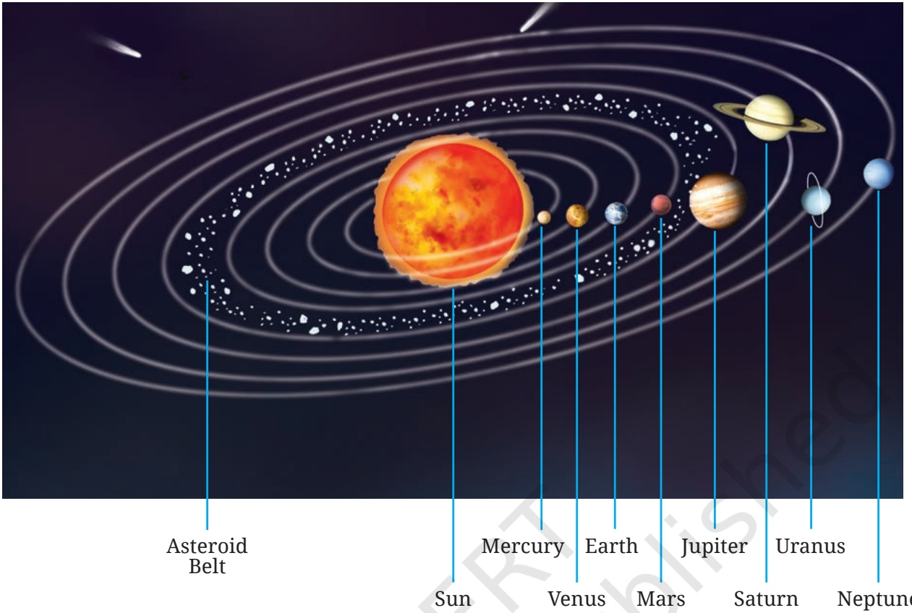

Fig. 12.7: An artist’s representation of the Solar System

(To fit this figure within the page, the sizes and distances of various objects are not as per their actual sizes and distances in relation to each other, that is, the sizes and distances are not to scale in the figure)

The eight planets, in order of their increasing distance from the Sun, are Mercury, Venus, Earth, Mars, Jupiter, Saturn, Uranus, and Neptune (Fig. 12.7).

The inner four planets nearest to the Sun—Mercury, Venus, Earth and Mars—are smaller in size. They have solid surfaces with rocks on them.

From ancient times, various names have been used across India for the planets visible to the naked eye. For example, Budha (Mercury), Śhukra (Venus), Pṛithvī (Earth), Mangala (Mars), Bṛihaspati or Guru (Jupiter) and Śhani (Saturn).

**More to know!**