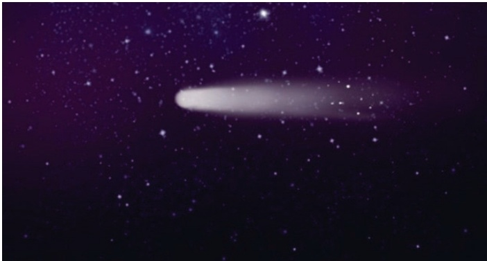

material forms the tail of the comet. Comets appear dim as they move away from the Sun and then, it is not possible to see them with the naked eye.

Fig. 12.10: A Comet

One famous comet is the Halley’s Comet which appears every 76 years. Its last appearance was in 1986.

In Sanskrit and a few other Indian More to More languages, a comet now! knov is called Dhūmaketu. Various tribes in India also call it Pucchya-Taro (star with a tail) or Zendya-Taro (star like a flag).

In many cultures, comets have been feared and it was earlier believed that comets bring bad luck. However, thanks to scientists, we now know that these are just icy-rocky visitors making a trip close to the Sun!

Many comets have been found that revolve around the Sun. These comets approach close to the Sun periodically. However, there are a few comets that escape and move out of the Solar System. Few other comets get broken up, or fall into the Sun or other planets when they approach them.

We have learnt about the objects which form the Solar System. Which are these objects? **The Sun, eight planets, their moons, and many smaller objects including asteroids, and comets, together form the Solar System**.

The Sun—our star—is the largest and the heaviest object in the Solar System. The Sun produces almost all the energy in the Solar System. All other objects in our Solar System shine due to the sunlight that they reflect from their surfaces.

What is beyond the Solar System?