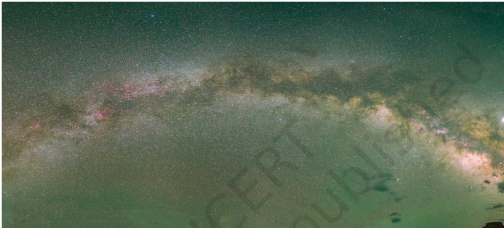

## 12.4 The Milky Way Galaxy

In the moonless night sky, viewed from dark locations away from city lights, one can see an extended faint band of light from near north to south across the sky (Fig. 12.11). This is our home galaxy called the Milky Way Galaxy or Ākāśha Gangā. A galaxy has millions to billions of stars. Our Solar System is part of the Milky Way Galaxy.

Fig. 12.11: Milky Way Galaxy as seen from a very dark location in Ladakh, India

## 12.5 The Universe

There are many galaxies in the outer space beyond the Milky Way Galaxy. Scientists study them to understand the stars, galaxies and the Universe.

We do not know yet if life exists elsewhere in the Universe. The search for life has been directed mostly towards exoplanets—the planets discovered revolving around other stars in our galaxy. Till now, scientists have not found any evidence of life but this search is on and continuing.

What is beyond the Milky Way Galaxy?

Is there life anywhere else in the Universe?

Beyond Earth