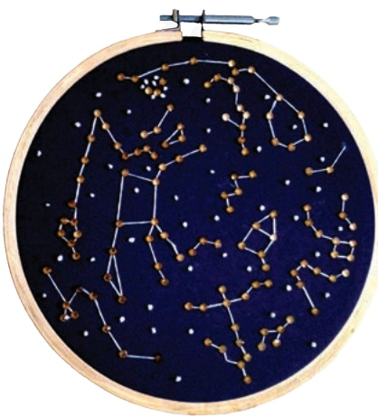
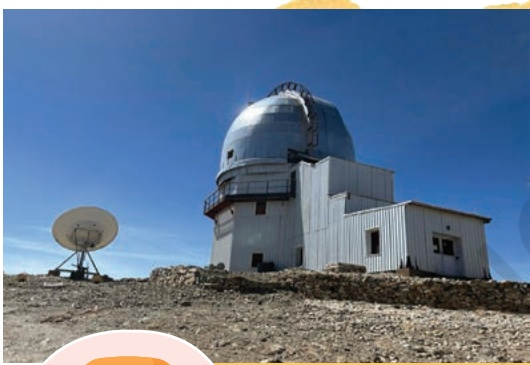
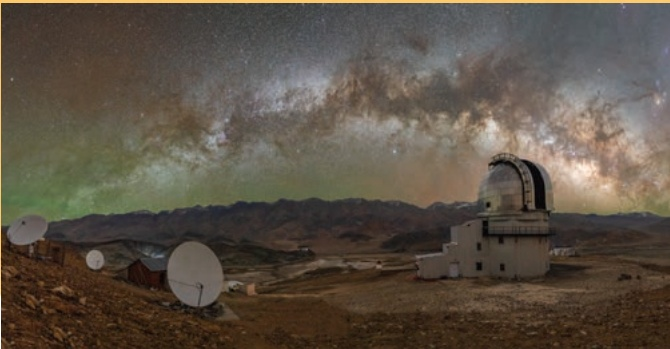

Fig. 12.15: Embroidery of constellations

Find out if the increasing light pollution is causing problems for humans, wildlife and the environment. Write an action that you would take at the personal level to control light pollution.

Find out the weather conditions due to which the Indian Institute of Astrophysics (IIA) found Hanle, Ladakh a suitable place to set up an observatory.

If you enjoy doing embroidery, try to embroider on a dark coloured cloth the constellations that you have seen (Fig. 12.15). Otherwise, you may use your creativity and depict constellations in multiple other ways using various art and craft ideas.

Indian Astronomical Observatory, Hanle, is situated atop the highest peak of Digparatsa-Ri mountain range in Hanle. This peak has been renamed Mount Saraswati.

It has several telescopes. One of them is called the Himalayan Chandra Telescope, which has been named after the Nobel

Prize winning scientist Subrahmanyan Chandrasekhar. It is an observatory at one of the highest locations in the world.

More to know!

The area surrounding this observatory was notified as the Hanle Dark Sky Reserve (HDSR) in December 2022. The reserve is open to the public throughout the year. Local people have been provided with small telescopes and are trained to be Astronomy

Ambassadors for visitors by the Indian Institute of Astrophysics. It is expected to promote astro-tourism in the region.

