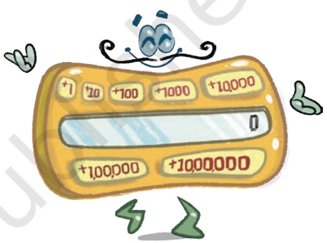

(c) 10,000?

(d) Fifty three thousand?

(e) 90,000?

(f) 97,600?

(g) 1,00,000?

(h) \_? 582 times

(i) How many hundreds are required to make ten thousand?

(j) How many hundreds are required to make one lakh?

(k) Handy Hundreds says, “There are some numbers which Tedious Tens and Thoughtful Thousands can’t show but I can.” Is this statement true? Think and explore.

4. **Creative Chitti** is a different kind of calculator. It has the following buttons: +1, +10, +100, +1000, +10000, +100000 and +1000000. It always has multiple ways of doing things. “How so?”, you might ask. To get the number 321, it presses +10 thirty two times and +1 once. Will it get 321? Alternatively, it can press +100 two times and +10 twelve times and +1 once.

5. Two of the many different ways to get 5072 are shown below: These two ways can be expressed as:

(a) (50 × 100) + (7 × 10) + (2 × 1) = 5072

(b) (3×1000) + (20×100) + (72 ×1) = 5072

Find a different way to get 5072 and write an expression for the same.

## Figure it Out

For each number given below, write expressions for at least two different ways to obtain the number through button clicks. Think like Chitti and be creative.

(a) 8300

(b) 40629

(c) 56354

<table><tbody><tr><td>Buttons</td><td colspan="2">5072</td></tr><tr><td>+10,00,000</td><td></td><td></td></tr><tr><td>+1,00,000</td><td></td><td></td></tr><tr><td>+10,000</td><td></td><td></td></tr><tr><td>+1,000</td><td></td><td>3</td></tr><tr><td>+100</td><td>50</td><td>20</td></tr><tr><td>+10</td><td>7</td><td></td></tr><tr><td>+1</td><td>2</td><td>72</td></tr></tbody></table>