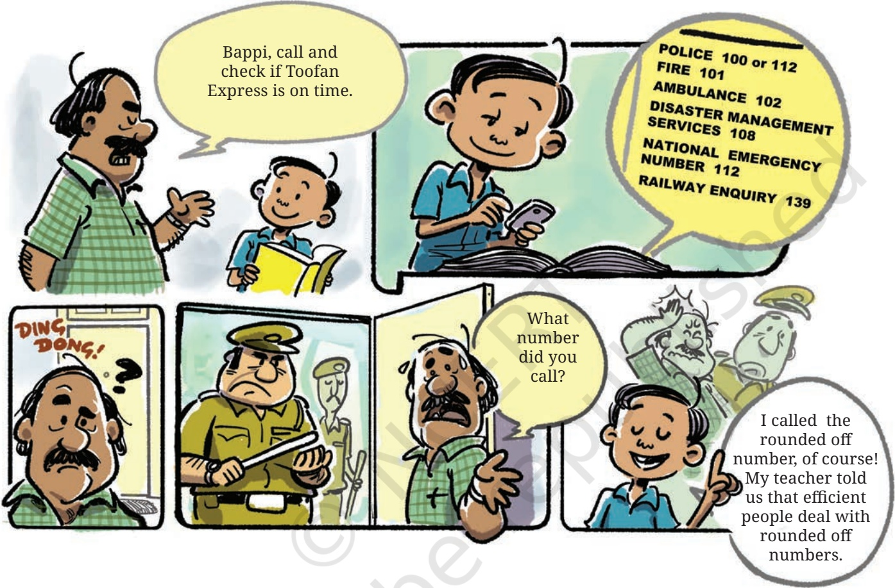

What do you think of this conversation? Have you read or heard such headlines or statements?

Very often, exact numbers are not required and just an approximation is sufficient. For example, according to the 2011 census, the population of Chintamani town is 76,068. Instead, saying that the population is about 75,000 is enough to give an idea of how big the quantity is.

There are situations where it makes sense to **round up** a number (rounding up is when the approximated number is more than the actual number). For example, if a school has 732 people including students, teachers and staff: the principal might order 750 sweets instead of 700 sweets.

There are situations where it is better to **round down** (rounding down is when the approximated number is less than the actual number). For example, if the cost of an item is ₹470, the shopkeeper may say that the cost is around ₹450 instead of saying it is around ₹500.

？ Think and share situations where it is appropriate to (a) round up, (b) round down, (c) either rounding up or rounding down is okay and (d) when exact numbers are needed.